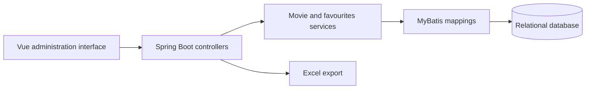

# Futao Ye

**Software development · Computer vision · Interactive prototypes**

MSc student in Metaverse Technology at The Hong Kong Polytechnic University, with a BSc in Software Engineering from South China Normal University. My experience includes Java backend development, Python image processing, semantic segmentation, and IoT device-to-cloud communication.

**Winter internship availability:** from early December 2026; exact dates and weekly schedule to be agreed.

## Selected projects

### MovieMind — Movie Recommendation Desktop App

A Python desktop app for browsing movies and receiving personalised recommendations. I worked on the SQLite data layer, including user IDs and storage and retrieval of user-added movie links. The app uses PySide6 for its interface and NumPy for its recommendation module.

**[Project case study](projects/moviemind.md)** · [Source repository](https://github.com/mtbasktm/MovieMind) · [My commits](https://github.com/mtbasktm/MovieMind/commits/main/?author=Fttt1003)

### Movie Catalogue and Favourites Backend

A movie application project built on RuoYi, using Java, Spring Boot and MyBatis. The available source implements movie search and filtering, actor/director relationships, favourites, pagination, and Excel export. The accompanying administration interface uses Vue 2 and Element UI.

My CV identifies my role as backend development and recommendation algorithm work. This showcase focuses on the backend functionality supported by the available source; the recommendation implementation is not included in the reviewed archive.

**[Explore the project case study →](projects/movie.md)**

### License Plate Recognition

Python/OpenCV coursework exploring recognition of mainland Chinese and Hong Kong plates. The pipeline uses HSV colour masks, morphological processing, perspective rectification, projection-based character segmentation and template matching, with intermediate visualisations for debugging.

**[Project overview](projects/license-plate-recognition.md)** · Source code and demonstration to be added.

## Additional experience

- **Accessible navigation:** segmentation-data preparation and DeepLabv3+ experiments, alongside an Android location and route-guidance prototype. The prototype reserved interfaces for future model integration.
- **IoT internship:** supported device monitoring and data visualisation, with EMQX/MQTT communication between devices and cloud services.

## Technical background

Python · Java · OpenCV · NumPy · scikit-learn · Spark DataFrame API · Spring Boot · MyBatis · MQTT / EMQX

## Interests

Building useful interactive prototypes, connecting application interfaces to backend services, and applying AI and computer vision to user-facing experiences. I am particularly interested in AI-assisted interaction and cultural applications.

## About this portfolio

This repository presents project documentation and an evidence map, rather than a hosted application. The movie source has been inspected, but no successful deployment, performance benchmark or recommendation-quality result is claimed. RuoYi provides the underlying application framework; its authentication, administration scaffolding and generated components are not presented as original work.
